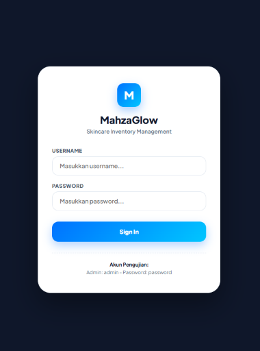
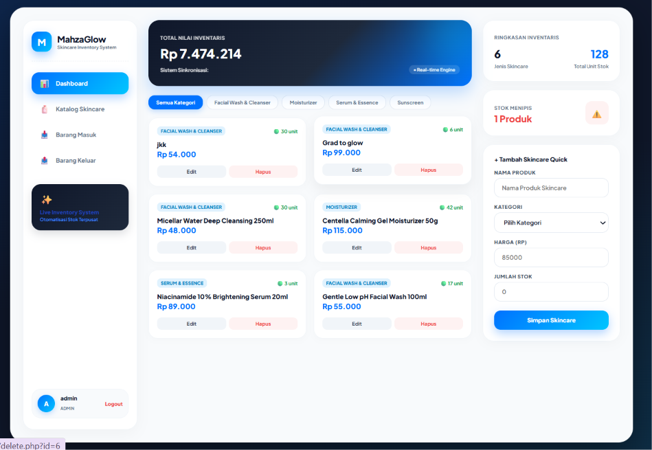
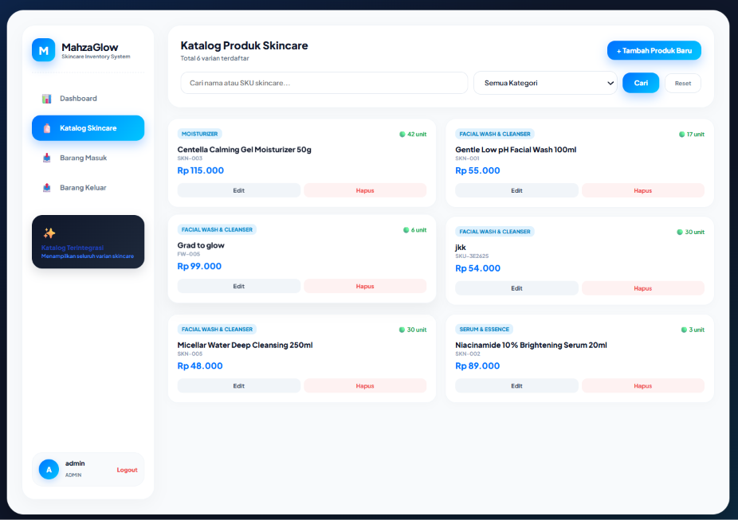
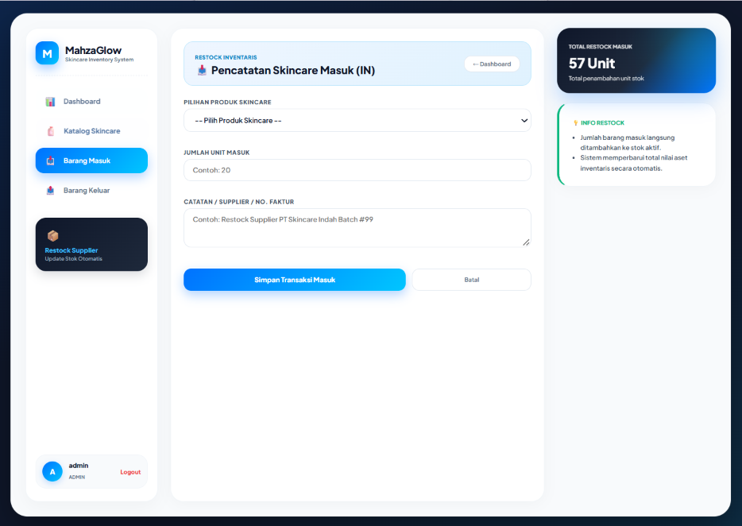
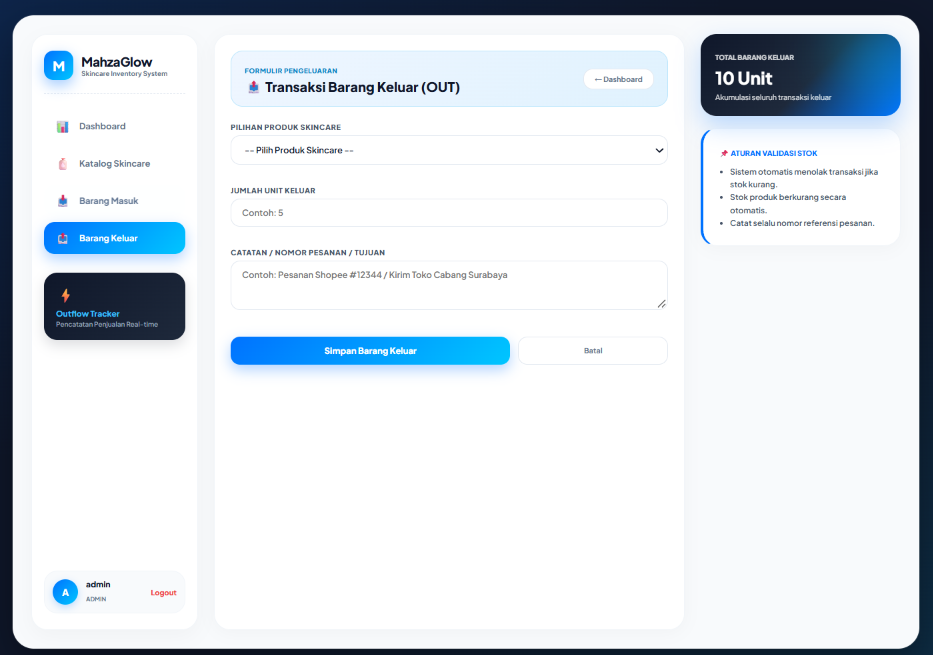
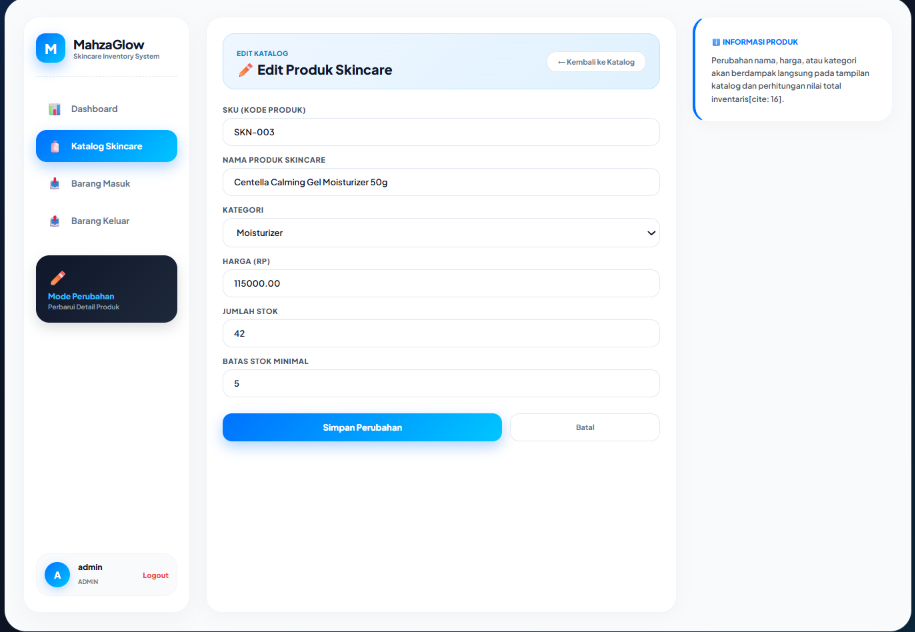

Berikut adalah isi lengkap dari file **`README.md`** yang bisa langsung Anda salin (*copy-paste*) ke dalam file **`README.md`** di folder proyek Anda:

```markdown
#  MahzaGlow - Skincare Inventory Management System

**MahzaGlow** adalah sistem manajemen inventaris produk *skincare* berbasis web yang dirancang dengan antarmuka **Fintech & SaaS Premium**. Aplikasi ini memudahkan pengelolaan katalog produk, pemantauan stok secara *real-time*, serta pencatatan transaksi barang masuk (*stock in*) dan barang keluar (*stock out*).

---

## Fitur Utama

- **Dashboard Visual & Analytics**:
  - Ringkasan total nilai aset inventaris secara *real-time*.
  - Indikator varian produk, total stok unit, serta peringatan stok menipis (*low stock alert*).
  - Filter cepat produk berdasarkan kategori.

- **Katalog Produk Terintegrasi**:
  - Pencarian produk berdasarkan Nama atau Kode SKU.
  - Tambah, Edit, dan Hapus data produk *skincare* (Khusus Akses Admin).
  - Penanganan otomatis format harga Rupiah (contoh: `Rp 99.000`).

- **Pencatatan Transaksi Stok (In/Out)**:
  - **Barang Masuk (IN)**: Menambah stok otomatis saat terjadi *restock* dari distributor/supplier.
  - **Barang Keluar (OUT)**: Mengurangi stok otomatis saat terjadi penjualan atau pengiriman pesanan.
  - Validasi stok otomatis untuk mencegah pengeluaran melebihi sisa stok yang ada.

- **Sistem Keamanan & Autentikasi**:
  - Akses berbasis peran (*Role-Based Access*: **Admin** & **Staff**).
  - Fitur *Auto-Recovery Login* yang memulihkan atau membuat akun `admin` secara otomatis jika terjadi masalah pada tabel/database.
  - Perlindungan terhadap kerentanan XSS (*Cross-Site Scripting*) dan SQL Injection.

---

## Teknologi yang Digunakan

- **Backend**: PHP 7.4+ (PDO Engine)
- **Database**: MySQL / MariaDB
- **Frontend**: HTML5, CSS3 Modern (Glassmorphism, Flexbox, CSS Grid)
- **Tipografi**: Plus Jakarta Sans (Google Fonts)

---

##  Struktur Folder Proyek


```

inventory-app/
├── config/
│   └── db.php               # Konfigurasi koneksi database PDO
├── helpers/
│   ├── auth.php             # Fungsi autentikasi & perizinan role
│   ├── escape.php           # Helper sanitasi XSS & formatRupiah()
│   └── validation.php       # Helper validasi input data
├── public/
│   ├── assets/
│   │   └── style.css        # Desain CSS terpusat Fintech/SaaS
│   ├── stock/
│   │   ├── in.php           # Formulir & logika transaksi Barang Masuk
│   │   └── out.php          # Formulir & logika transaksi Barang Keluar
│   ├── create.php           # Form tambah produk baru
│   ├── dashboard.php        # Halaman utama Ringkasan Inventaris
│   ├── delete.php           # Skrip penghapusan produk
│   ├── edit.php             # Form ubah data produk
│   ├── index.php            # Halaman Katalog Produk
│   ├── login.php            # Halaman autentikasi pengelola
│   └── logout.php           # Skrip keluar dari sistem
└── README.md                # Dokumentasi proyek

```

---

## Panduan Instalasi & Penggunaan

### 1. Persyaratan Sistem
- Server Lokal: **XAMPP / Laragon / WAMP**
- PHP versi **7.4** atau yang lebih baru
- Database **MySQL**

### 2. Langkah Setup
1. Unduh atau salin folder proyek `inventory-app` ke dalam direktori server lokal Anda:
   - XAMPP: `C:/xampp/htdocs/inventory-app/`
2. Buka **phpMyAdmin** (`http://localhost/phpmyadmin/`) lalu buat database baru bernama `inventory_db`.
3. Buat tabel utama yang dibutuhkan (`users`, `categories`, `products`, `stock_movements`).
4. Jalankan Apache dan MySQL melalui control panel (XAMPP/Laragon).

### 3. Login Pengujian
Buka browser lalu navigasikan ke:
`http://localhost/inventory-app/public/login.php`

Gunakan kredensial pengujian berikut:
- **Username**: `admin`
- **Password**: `password`
- **Role**: Admin (Akses Penuh)

---

## Lisensi & Hak Cipta
Dikembangkan untuk **MahzaGlow Skincare System**. Bebas disesuaikan dan dikembangkan lebih lanjut untuk kebutuhan manajemen inventaris toko/brand skincare.

```

## Tampilan Aplikasi
### Login

### Dasboard

### Katalog

### Barang Masuk

### Barang Keluar

### Edit
