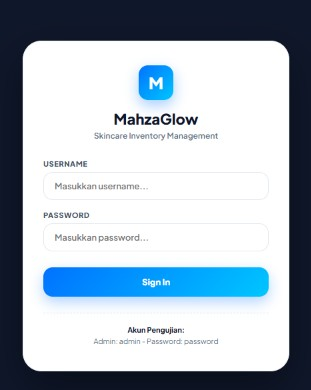
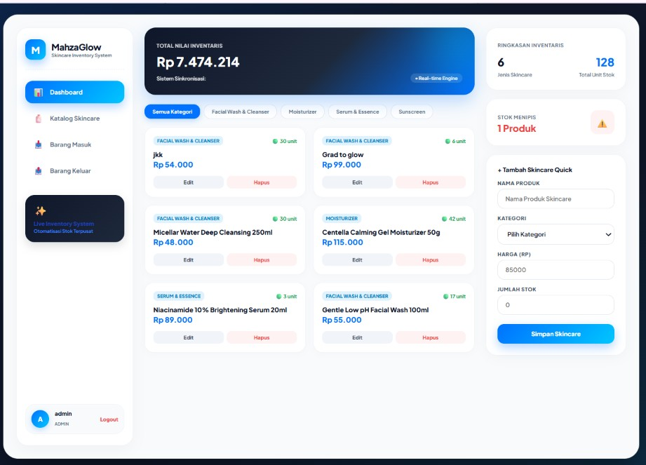
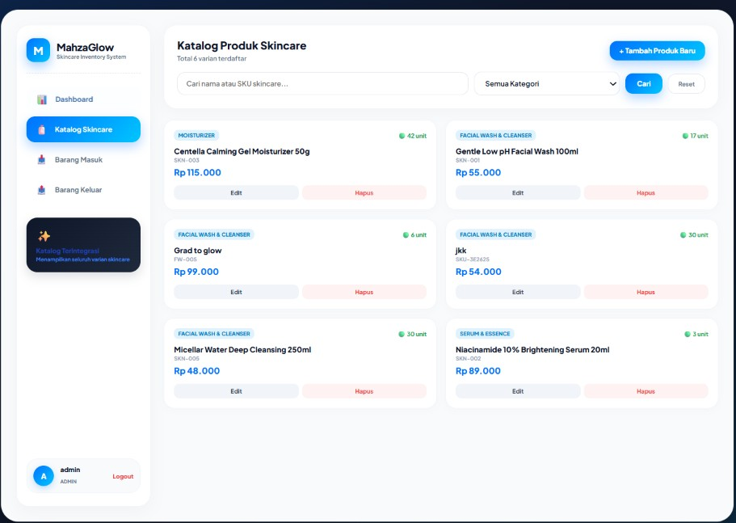
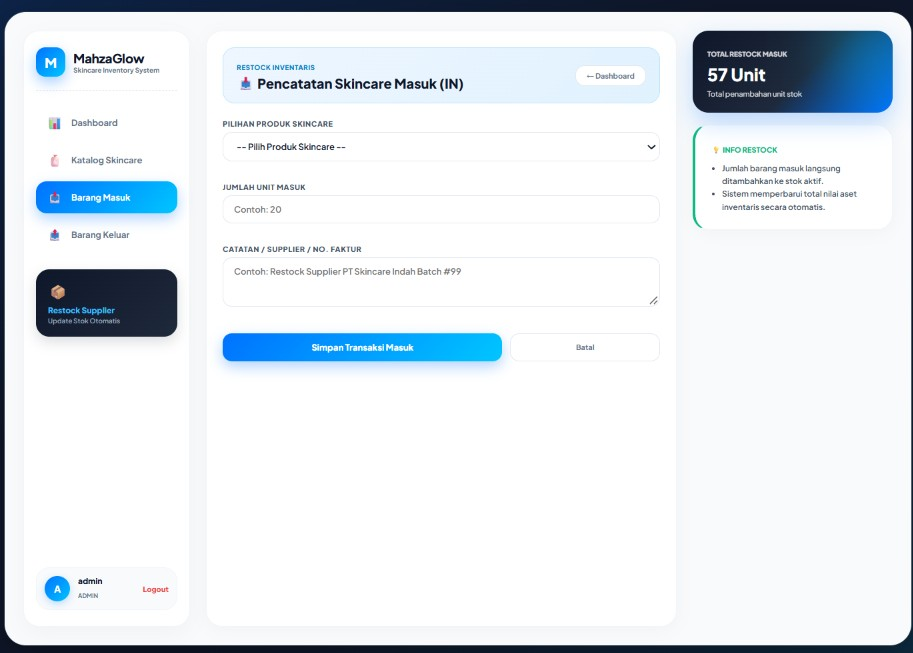

# **MahzaGlow - Skincare Inventory Management System**

**MahzaGlow** adalah sistem manajemen inventaris produk *skincare* berbasis web yang dirancang dengan antarmuka **Fintech & SaaS Premium**. Aplikasi ini memudahkan pengelolaan katalog produk, pemantauan stok secara *real-time*, serta pencatatan transaksi barang masuk (*stock in*) dan barang keluar (*stock out*).

---

## **Tampilan Antarmuka Aplikasi**

### **1. Halaman Login**

### **2. Dashboard Utama**

### **3. Katalog Skincare**

### **4. Pencatatan Barang Masuk (IN)**

### **5. Pencatatan Barang Keluar (OUT)**

### **6. Formulir Edit Produk**

---

## **Fitur Utama & Spesifikasi Sistem**

| **Kategori** | **Detail Modul / Fitur** |
| :--- | :--- |
| **Dashboard Visual & Analytics** | - **Ringkasan total nilai aset inventaris secara real-time.** - **Indikator varian produk, total stok unit, serta peringatan stok menipis (low stock alert).** - **Filter cepat produk berdasarkan kategori.** |
| **Katalog Produk Terintegrasi** | - **Pencarian produk berdasarkan Nama atau Kode SKU.** - **Tambah, Edit, dan Hapus data produk skincare (Khusus Akses Admin).** - **Penanganan otomatis format harga Rupiah (contoh: `Rp 99.000`).** |
| **Pencatatan Transaksi Stok** | - **Barang Masuk (IN): Menambah stok otomatis saat terjadi restock dari supplier.** - **Barang Keluar (OUT): Mengurangi stok otomatis saat terjadi penjualan.** - **Validasi stok otomatis untuk mencegah pengeluaran melebihi sisa stok.** |
| **Keamanan & Autentikasi** | - **Akses berbasis peran (Role-Based Access: Admin & Staff).** - **Fitur Auto-Recovery Login untuk akun admin.** - **Perhitungan sanitasi input dari kerentanan XSS dan SQL Injection.** |
| **Teknologi yang Digunakan** | - **Backend: PHP 7.4+ (PDO Engine)** - **Database: MySQL / MariaDB** - **Frontend: HTML5, CSS3 Modern (Glassmorphism, Flexbox, CSS Grid)** - **Tipografi: Plus Jakarta Sans (Google Fonts)** |

---

## **Panduan Instalasi & Penggunaan**

| **Langkah / Modul** | **Instruksi Lengkap & Kredensial** |
| :--- | :--- |
| **1. Persyaratan Sistem** | **Pastikan perangkat lokal Anda telah terinstal:** - **Server Lokal: XAMPP / Laragon / WAMP** - **PHP: Versi 7.4 atau yang lebih baru** - **Database: MySQL / MariaDB** |
| **2. Langkah Setup** | **1. Salin folder `inventory-app` ke lokasi server lokal:** &nbsp;&nbsp;&nbsp;&nbsp;`C:/xampp/htdocs/inventory-app/`  **2. Buka phpMyAdmin (`http://localhost/phpmyadmin/`) lalu buat database baru:** &nbsp;&nbsp;&nbsp;&nbsp;Nama Database: `inventory_db`  **3. Buat tabel utama yang dibutuhkan (`users`, `categories`, `products`, `stock_movements`).**  **4. Jalankan modul Apache dan MySQL melalui Control Panel.** |
| **3. Login Pengujian** | **Navigasikan browser ke alamat:** `http://localhost/inventory-app/public/login.php`  **Kredensial Akun Uji Coba:** - **Username**: `admin` - **Password**: `password` - **Role**: `Admin` (Akses Penuh) |
| **Struktur Folder Proyek** | `inventory-app/` ├── `config/db.php` *(Konfigurasi koneksi database PDO)* ├── `helpers/` *(auth.php, escape.php, validation.php)* ├── `img/` *(Kumpulan gambar screenshot antarmuka UI)* ├── `public/` *(assets/style.css, stock/in.php, stock/out.php)* ├── `public/` *(create.php, dashboard.php, edit.php, index.php, login.php)* └── `README.md` *(Dokumentasi terstruktur proyek)* |
| **Lisensi & Hak Cipta** | **Dikembangkan untuk MahzaGlow Skincare System. Bebas disesuaikan dan dikembangkan lebih lanjut untuk kebutuhan manajemen inventaris toko/brand skincare.** |
